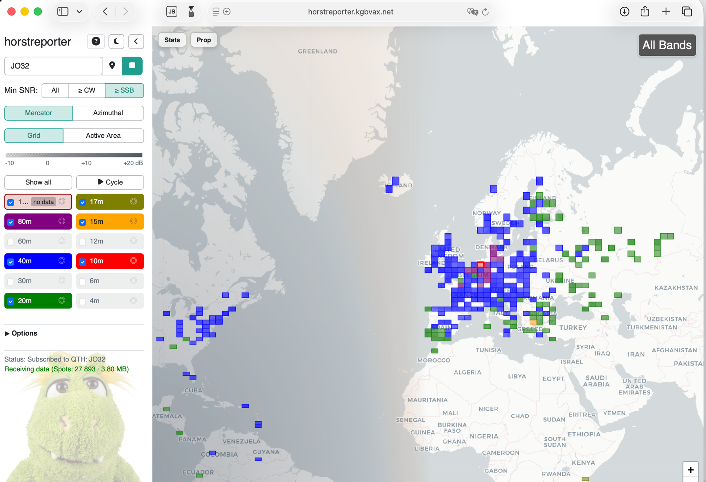

# HorstReporter

HorstReporter shows live conditions on the HF (shortwave) radio bands. It is one Go program with a web interface that uses plain ES modules (JavaScript files that the browser loads directly).

The program receives spot data from PSK Reporter over MQTT (a messaging protocol). A spot is a report that one station heard another station. The program uses FT8 spots (a digital radio mode) to calculate the conditions on each band. It then serves a web page and SSE streams (one-way streams of live updates from server to browser).

You can also add data from RBN and WSPR. These are optional.



You do not need a radio to use it. The program reads public spot data. It needs only your locator, which is a Maidenhead grid square (a code for a map area). The program uses your locator as your QTH (your station location).

## What it does

- It gives each band a live score, a confidence value, and a status.
- The status is `green`, `yellow`, `red`, or `grey`.
- It lists the best and worst bands (`best_bands`, `recommended_bands`, `worst_bands`, `avoid_bands`).
- It shows the trend of each band as a sparkline (a small line chart).
- It shows which modes are possible: `ssb`, `cw`, `digital`, or `none`.
- It shows the main direction of the signals as a sector, such as `N` or `NE`.
- It shows propagation intelligence at `GET /api/prop_intel/v2`. This is a short-term forecast for each band and region. It always starts from your QTH.
- It also gives a summary at `/api/prop_intel/summary`. The server caches this summary for 60 seconds. The horstapp mobile widgets use it.

For the response shapes, caches, and exclusions of each endpoint, read [docs/api.md](docs/api.md).

## Quickstart

You need Go 1.24 or later to build and start the program. You need Node and npm for the frontend tests and the type check.

Postgres is optional. If you set no connection string, the server keeps its history in memory. You need Postgres to keep data between restarts, to use replay baselines, and to use the raw-spot store.

To start the server, enter this command:

```bash
go run ./cmd/horstreporter -dev -port 8080
```

Open `http://localhost:8080`. You see a Mercator map of recent FT8 spots around your locator. The page also shows a status chip and recommendations for each band.

To see all flags and their defaults, enter this command:

```bash
go run ./cmd/horstreporter -h
```

To test the backend, enter `go test ./...`. To type-check and test the frontend, enter `npm run check`.

## Optional data sources

Both optional sources are off until you enable them with a flag. Pass secrets in environment variables, not on the command line. For details, read [docs/deployment-secrets.md](docs/deployment-secrets.md).

The server marks RBN and WSPR spots with a `source_type`. These spots are not in the FT8 baseline of conditions. They are in the activity chart and the live stream.

To enable RBN (Reverse Beacon Network), use `-rbn-enable`. RBN is a public telnet relay for CW and RTTY spots. It asks for a callsign before it sends data.

```bash
go run ./cmd/horstreporter -dev -port 8080 -rbn-enable -rbn-callsign <yourcall>
```

To enable WSPR, use `-wspr-enable`. The server polls the wspr.live ClickHouse database. WSPR data is for reference only.

```bash
go run ./cmd/horstreporter -dev -port 8080 -wspr-enable
```

## Companion tools

`cmd/horstoperator-agent` is a local agent. It connects the browser's operator mode to PSTrotator (antenna rotator software) over UDP. It uses a built-in command profile, so you do not write templates.

If you set `-rig-transport`, the agent can also tune your radio through WaveLogGate or Log4OM.

```bash
go run ./cmd/horstoperator-agent -listen 127.0.0.1:9955 -station-locator JO62qm
```

To see the flags of the agent, enter `go run ./cmd/horstoperator-agent -h`. For its environment variables, read [docs/deployment-secrets.md](docs/deployment-secrets.md). The interface that the browser uses is in [docs/dxcluster-agent-api.md](docs/dxcluster-agent-api.md).

`../horstapp` is a sibling Flutter mobile app for iOS and Android. It reads data from this backend and does not write to it. Its home-screen widgets get data from `/api/prop_intel/summary`.

## More documentation

- [docs/api.md](docs/api.md): each HTTP endpoint, with response shapes, caches, and exclusions
- [docs/deployment-secrets.md](docs/deployment-secrets.md): how to pass secrets to the server and the agent
- `CLAUDE.md`: architecture map, commands, and development constraints
